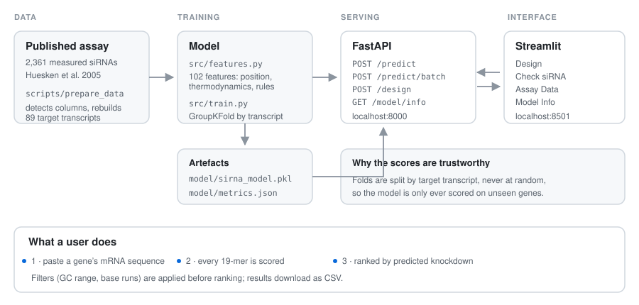

<div align="center">

# 🧬 siRNAPredict

**Predict siRNA knockdown from sequence, and rank candidates against any target transcript.**

[](https://github.com/sushantm47/sirnapredict/actions/workflows/tests.yml)
[](https://www.python.org/)
[](https://streamlit.io/)
[](https://fastapi.tiangolo.com/)
[](https://scikit-learn.org/)
[](LICENSE)

**MLOps Streamlit Lab 1** · IE-7374, Northeastern University (Boston) · Sushant M

</div>

> **Research and educational use only.** This tool ranks candidate sequences from published
> laboratory data. It is not validated for therapeutic design, not a medical device, and not a
> substitute for experimental testing.

---

## The problem

To switch off a gene you order an siRNA: a 19-letter sequence that binds the gene's mRNA and gets it
destroyed. The catch is that most designs barely work. Of the 2,361 siRNAs in the dataset behind this
project, **only half silenced their target by 70% or more** — and the only way to tell in advance is
to guess well.

So: given a gene, which siRNA should you order? This project learns the answer from published
laboratory measurements, serves it as an API, and puts a dashboard in front of it.



## What it does

| Page | Question it answers |
|---|---|
| 🔍 **Design** | "I want to silence this gene — which siRNA should I order?" Paste the mRNA; every possible 19-mer is scored and ranked |
| 🔬 **Check siRNA** | "I already have some candidates — are they any good?" Scores them and shows which design rules each one breaks |
| 📈 **Assay Data** | "What was this trained on?" The real measurements, browsable |
| 📊 **Model Info** | "How much should I trust it?" Scores, validation scheme, and what drives the predictions |

## How it works

**Turning a sequence into numbers (102 features).** Which base sits at each of the 19 positions, the
overall composition, and the RNA folding energies (Xia et al. 1998). The most useful of these is
**end asymmetry**: if one end of the siRNA is easier to pull apart than the other, the cell loads the
right strand into the silencing machinery (Khvorova et al. 2003; Schwarz et al. 2003). The
Reynolds et al. (2004) checklist, which bench scientists apply by hand, goes in as a feature too.

**Testing it honestly.** siRNAs designed against the same gene overlap each other, so splitting the
data at random would let the model memorise near-copies of its own test set and look much better than
it is. Instead, folds are split **by gene** (`GroupKFold`): the model is always scored on genes it has
never seen, which is the situation it faces on a new target.

**Compared against something real.** A ridge regression and gradient-boosted trees are both scored on
identical folds against the **Reynolds checklist alone** — what people used before machine learning.

## Results

### On real published data

Fitted on the **Hüsken et al. (2005)** library: 2,361 siRNAs, half of them active at the usual ≥70%
knockdown threshold, in 89 target groups reconstructed from mRNA context. Every score is out-of-fold
from 5-fold `GroupKFold` **grouped by target transcript**.

| Model | Pearson r | Spearman ρ | MAE | AUC |
|---|:---:|:---:|:---:|:---:|
| Reynolds rules (baseline) | 0.493 | 0.498 | — | 0.755 |
| **Ridge regression** ⭐ | **0.612** | **0.623** | **0.121** | **0.823** |
| Gradient-boosted trees | 0.594 | 0.607 | 0.123 | 0.813 |

**r = 0.61 on unseen transcripts**, against 0.49 for the published rule checklist alone — the learned
model adds about 0.12 of correlation over the rules it was handed as a feature. Published siRNA
predictors report r in the 0.6–0.67 range on this dataset, usually on splits that do *not* hold out
whole genes. Median per-transcript r is **0.67**, with a 0.34–0.83 spread across genes.

The simpler model winning is worth noting: with ~2.4k examples and 102 features, ridge generalises to
new transcripts slightly better than boosted trees.

**The top weights line up with the published biology** rather than contradicting it:

| Feature | Why it matters |
|---|---|
| `reynolds_score` | The design-rule checklist carries real signal |
| `pos1_U`, `pos1_G`, `pos1_C` | The base at the guide's 5′ end — the strand-asymmetry rule |
| `pos19_A`, `pos19_C`, `pos19_G` | The base at the guide's 3′ end, the other side of the duplex |
| `end_asymmetry` | Thermodynamic difference between the guide's two ends |

*That dataset is not redistributed here. To reproduce these numbers, obtain it (see
[Data and attribution](#data-and-attribution)) and run `prepare_data` then `train`.*

### What ships in this repo

So that everything runs on clone, the committed model is fitted on `data/synthetic_demo.csv` — a
simulated dataset generated from the same published design rules. On it the pipeline reaches
r ≈ 0.80, but **that number is circular and is not a performance claim**: the model is recovering a
formula this repository wrote. It demonstrates that the pipeline works, nothing more. The table above
is the result that means something.

The synthetic model is still useful in practice, because the rules it learned are real ones — it
ranks the known-potent and known-dud siRNAs below correctly.

## Setup

Requires Python 3.12+. A trained model and a synthetic dataset are committed, so the whole stack
runs with no downloads. Real published data is **not** redistributed here — see
[Data and attribution](#data-and-attribution).

```bash
python -m venv sirna_env && source sirna_env/bin/activate   # Windows: sirna_env\Scripts\Activate.ps1
pip install -r requirements.txt

uvicorn src.api:app --reload      # http://localhost:8000/docs
streamlit run app/Dashboard.py    # http://localhost:8501
```

Retrain on the committed synthetic data:

```bash
python -m scripts.prepare_data data/synthetic_demo.csv
python -m src.train
```

Or on a real published dataset, once you have one:

```bash
python -m scripts.prepare_data path/to/raw.csv   # writes data/sirna_efficacy.csv (git-ignored)
python -m src.train
```

`prepare_data` detects the sequence, efficacy and target columns by name and falls back to
inspecting the contents; override with `--guide-column`, `--efficacy-column`, `--target-column`.
Files that carry an mRNA context window instead of a gene label — the Huesken distribution is one —
have their transcripts reconstructed automatically, which is what makes grouped validation possible.

The dashboard reads `API_URL` (default `http://localhost:8000`); the API reads `MODEL_PATH`.
`scripts/make_demo_data.py` writes a synthetic dataset if you want to exercise the stack without a
download — the sequences and efficacies in it are simulated, not measured.

## Check that it works

Six siRNAs from the dataset with known laboratory results — three that silenced their target
completely, three that did essentially nothing. A working model should score the first group well
above the second.

| Guide (5'→3') | Measured in the lab |
|---|---|
| `UAAUUGUGGCUUGCCAAUG` | 100% knockdown |
| `AAAAGAAUACACCGCCUUG` | 100% |
| `UGUUAAAGCAGGCGACCAC` | 100% |
| `CGUGCGCAUGGUGGAAAAG` | 0% |
| `GCCCAUCAAAUGGGAAGUU` | 0.2% |
| `CCGGCAAACCGAAGAACUU` | 1.8% |

**In the dashboard:** open **Check siRNA → Several guides**, paste the contents of
`examples/guides_to_paste.txt`, and click Score. With the committed model the three strong ones score
around 0.74–0.76 and the three weak ones around 0.13–0.18 — a clean split, even though that model
never saw these sequences or any real measurement.

**From the command line**, with the API running:

```bash
curl -X POST http://localhost:8000/predict \
  -H "Content-Type: application/json" \
  -d '{"guide": "UAAUUGUGGCUUGCCAAUG"}'     # strong  -> ~0.74, "active"

curl -X POST http://localhost:8000/predict \
  -H "Content-Type: application/json" \
  -d '{"guide": "GCCCAUCAAAUGGGAAGUU"}'     # weak    -> ~0.18, "inactive"
```

Exact numbers shift with library versions and with which dataset the model was fitted on; the
ordering is the point. `examples/` also holds `example_transcript.fa` for the Design page.

Other things worth poking at:

- Send a bad sequence (`{"guide": "AUGC"}`) — a 422 with a readable reason, not a stack trace.
- Stop the API and reload the dashboard — it says the backend is offline instead of hanging.
- `GET /model/info` returns every score in the results table above, straight from the trained model.

## API

| Method | Endpoint | Purpose |
|---|---|---|
| `GET` | `/health` | Is the service up, and is a model loaded? |
| `GET` | `/model/info` | Validation scheme, CV scores, top features, per-gene performance |
| `POST` | `/predict` | Score one guide + design-rule checklist |
| `POST` | `/predict/batch` | Score up to 500 guides |
| `POST` | `/design` | Scan a transcript, return ranked candidates |
| `POST` | `/design/profile` | Predicted knockdown at every position, for plotting |

```bash
curl -X POST http://localhost:8000/predict \
  -H "Content-Type: application/json" \
  -d '{"guide": "UUGAUAUGUUGGAUGAUGG"}'
```

```json
{
  "guide": "UUGAUAUGUUGGAUGAUGG",
  "sense": "CCAUCAUCCAACAUAUCAA",
  "predicted_knockdown": 0.72,
  "call": "active",
  "properties": { "gc_content": 0.368, "dg_total": -29.41, "end_asymmetry": 3.23 },
  "rule_check": { "passed": 6, "total": 7, "rules": { "gc_30_52": true, "u_at_sense_10": false } }
}
```

## What I changed from the original lab

The original Streamlit lab builds a one-page front end that uploads a JSON file to a FastAPI
Iris classifier.

| Area | Original lab | This repo |
|---|---|---|
| **Domain** | Iris flowers | siRNA knockdown efficacy — the prediction problem behind RNA therapeutics |
| **Features** | 4 given measurements | 102 engineered from sequence: position one-hot, composition, **RNA nearest-neighbour thermodynamics**, published design rules |
| **Validation** | random split | **`GroupKFold` by target gene** — the model never sees its test genes, plus a published rule-based baseline on the same folds |
| **Backend** | separate lab's Iris API | purpose-built API in this repo, including a `/design` endpoint that scans a whole transcript |
| **Pages** | one | **four**: Design, Check siRNA, Assay Data, Model Info |
| **Health check** | `GET /` returns 200, plus checking the backend's `.pkl` exists on disk | `GET /health` reports online **and** whether a model is loaded, with its version — no filesystem coupling between front end and backend |
| **Input** | upload a JSON file | paste a sequence, upload FASTA, use an example, or paste a guide list |
| **Output** | predicted class | ranked candidates, knockdown profile along the transcript, rule checklist, thermodynamics, CSV download |
| **Error handling** | toast with a status code | validation errors surfaced in plain language (`guide: must be 19 nucleotides long`) |
| **Config** | hard-coded URL and model path | `API_URL` and `MODEL_PATH` environment variables |
| **Testing** | none | **71 tests** — features, thermodynamics, loader, training, API, dashboard, and Streamlit `AppTest` page tests — plus CI with lint, coverage and a live API smoke test |

## Project structure

```
.
├── app/                      # Streamlit front end
│   ├── Dashboard.py          #   Design: scan a transcript
│   ├── pages/
│   │   ├── 1_Check_siRNA.py  #   Score guides you already have
│   │   ├── 2_Assay_Data.py   #   Explore the measured data
│   │   └── 3_Model_Info.py   #   Validation and scores
│   ├── api_client.py
│   └── helpers.py            #   FASTA parsing, tables (pure, tested)
├── src/                      # Model and API
│   ├── features.py           #   sequence → 102 features, thermodynamics, design rules
│   ├── data.py               #   flexible loader for published datasets
│   ├── train.py              #   grouped CV, model comparison, metrics
│   └── api.py                #   FastAPI service
├── data/synthetic_demo.csv   # simulated dataset, so the repo runs on clone
├── examples/                 # sample inputs for trying the tool
├── scripts/
│   ├── prepare_data.py       #   downloaded file → tidy CSV
│   └── make_demo_data.py     #   synthetic data for demos
├── tests/
└── .github/workflows/tests.yml
```

## Data and attribution

The model is trained on the siRNA knockdown library of **Hüsken et al. (2005)**: siRNAs against human
and rodent transcripts, all measured in a single experiment — still the largest public
single-experiment library and the usual benchmark for siRNA design tools. 2,361 rows survive cleaning.

> Hüsken, D. *et al.* (2005). Design of a genome-wide siRNA library using an artificial neural
> network. *Nature Biotechnology* 23(8), 995–1001. https://doi.org/10.1038/nbt1118

**The dataset is not redistributed in this repository.** Obtain it from the publication above or
another source whose terms permit your use, then run `scripts/prepare_data.py` on it. The loader
detects column names automatically and reconstructs target transcripts from mRNA context where no
gene column exists, so it accepts the common published layouts without editing.

What *is* committed: `data/synthetic_demo.csv` (generated by `scripts/make_demo_data.py`, simulated
not measured), the model fitted on it, and `model/metrics.json`. None of these contains or can
reconstruct real measurements. `examples/guides_known.csv` lists six sequences with their published
efficacies, quoted from Hüsken et al. for verification.

Design rules and thermodynamics implemented in `src/features.py` are cited in the source
(Reynolds et al. 2004; Khvorova et al. 2003; Xia et al. 1998).

The data is nucleotide sequences and in-vitro assay measurements. It contains no personal,
human-subject or clinical data. Full notices, including an independence statement and AI-assistance
disclosure, are in [NOTICE.md](NOTICE.md).

## Limitations

- Predicts **on-target knockdown only** — no off-target or immunogenicity prediction, both of which
  matter as much in practice.
- Trained on **unmodified** siRNAs. Therapeutic oligonucleotides are chemically modified, and those
  modifications change potency in ways this model cannot see.
- Published datasets differ in cell line and assay, so absolute numbers do not transfer cleanly
  between them.
- This is a **ranking aid**, not a replacement for experimental validation. Outputs are hypotheses
  to test at the bench, and carry no safety, efficacy or regulatory claim.

## Tests

76 tests, none of which need a running API, a network connection or the real dataset — the API is
exercised through FastAPI's `TestClient`, the dashboard through Streamlit's `AppTest`, and the model
through a synthetic dataset generated from the design rules.

```bash
pytest                       # whole suite, ~4s
pytest --cov=src --cov=app   # with coverage
```

CI additionally lints, enforces a coverage floor, and smoke-tests a trained model behind a live
`uvicorn` process.

## License

Code is MIT — see [LICENSE](LICENSE). Data attribution, method citations and other notices are in
[NOTICE.md](NOTICE.md).
